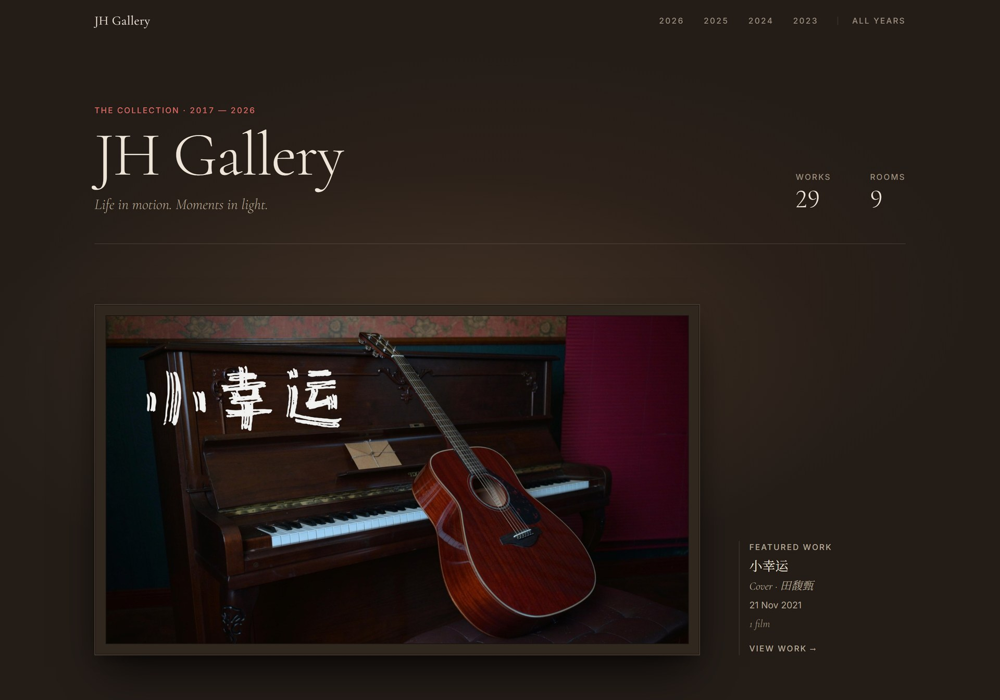

# JH Gallery



A personal gallery of photos and films, hung like a museum: each year is a room, and works are ordered by **when they were filmed or photographed**, newest first.

Plain HTML, CSS and JavaScript, with no framework or build step. Hosted on AWS (private S3 behind CloudFront), defined in Terraform.

**[Live Demo](https://gallery.jessamyh.com)**

## How it works

```
Local archive ──tools/build.py──▶ web media + works.local.js ──tools/deploy.sh──▶ S3 (private) ──▶ CloudFront (HTTPS)
```

- **Build:** `tools/build.py` turns the original archive into web copies. It resizes photos, makes 1200px copies for smaller screens, compresses video to 1080p, and strips EXIF/GPS metadata.
- **Deploy:** `tools/deploy.sh` uploads only the media the gallery refers to, sets cache headers and refreshes CloudFront.
- **Host:** S3 is private and only CloudFront can read it (Origin Access Control). CloudFront serves the site over HTTPS on `gallery.jessamyh.com` (ACM certificate, DNS on Cloudflare) with security headers and `noindex`, so it's shared by link and kept out of search engines.

## Privacy

Real photos, videos and titles never go into this repo. They live in a local archive, and the generated files (`media/archive/`, `data/works.local.js`) are git-ignored. The repo only holds sample works.

## Structure

```
index.html            page shell and viewer
styles.css            look and feel
script.js             timeline, rooms and viewer
data/works.js         sample works
data/works.local.js   real works, generated (git-ignored)
media/samples/        sample media
media/archive/        real media, generated (git-ignored)
tools/build.py        archive → web media
tools/deploy.sh       web media → S3 + CloudFront
infra/                Terraform: S3, CloudFront, OAC, ACM, policies
```

## Usage

**View locally:** open `index.html` in a browser.

**Build** (on the machine that has the archive; needs Python with Pillow, and ffmpeg):

```
python tools/build.py --data
```

Re-runs only convert what changed. Titles, tags and descriptions come from `meta.json` beside the archive; see the docstring in `tools/build.py`.

**Deploy** (needs the AWS CLI and the infrastructure in place):

```
tools/deploy.sh --dry-run   # preview
tools/deploy.sh
```

**Infrastructure:** see [infra/README.md](infra/README.md). State is local and backed up by hand.

## Adding a work by hand

Without the archive, add a record to `data/works.js`:

```js
{
  id: "2025-spring-recital",
  title: "Spring Recital",
  date: "2025-04",              // "2025" | "2025-04" | "2025-04-12", when it was filmed
  location: "Sydney",           // optional
  tags: ["Piano", "Singing"],   // optional
  description: "One or two lines of background.",
  featured: true,               // optional: opens the page
  media: [
    { type: "image", src: "media/2025-spring-recital/01.jpg", alt: "On stage" },
    { type: "video", src: "media/2025-spring-recital/song.mp4", poster: "media/2025-spring-recital/song.jpg" },
  ],
},
```

Order doesn't matter; the site sorts by date. Use JPG/WebP photos about 2000–2500px on the long edge, and MP4 (H.264 + AAC) videos with a `poster` image. Nothing is cropped, so any aspect ratio works.

After changing `styles.css` or `script.js`, bump the `?v=` number on its link in `index.html`.
